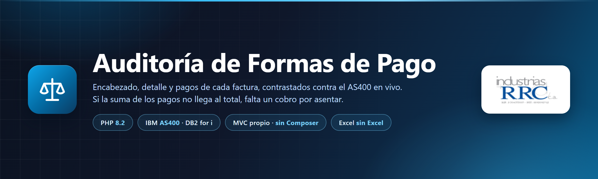
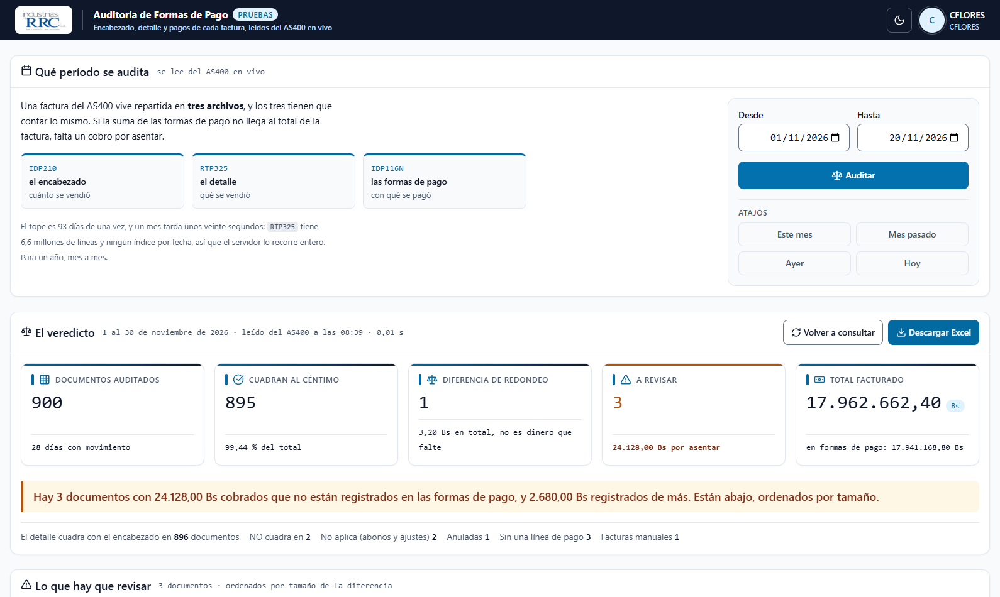
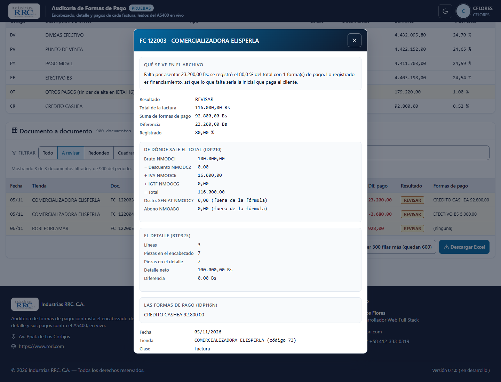
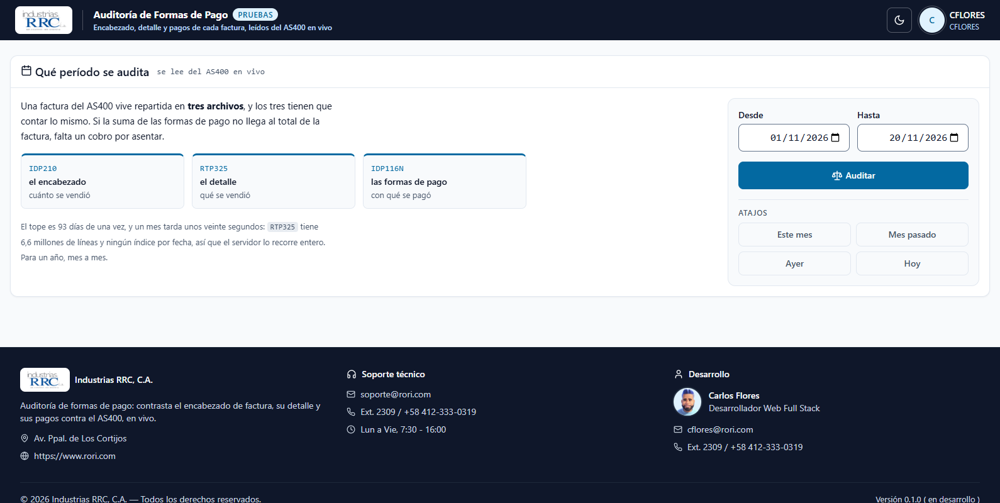
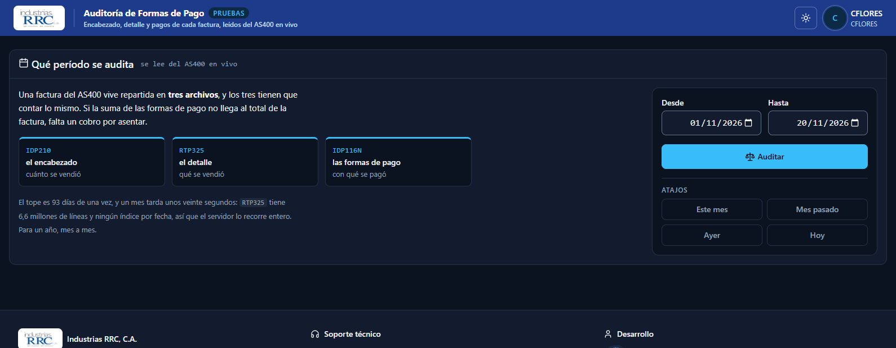
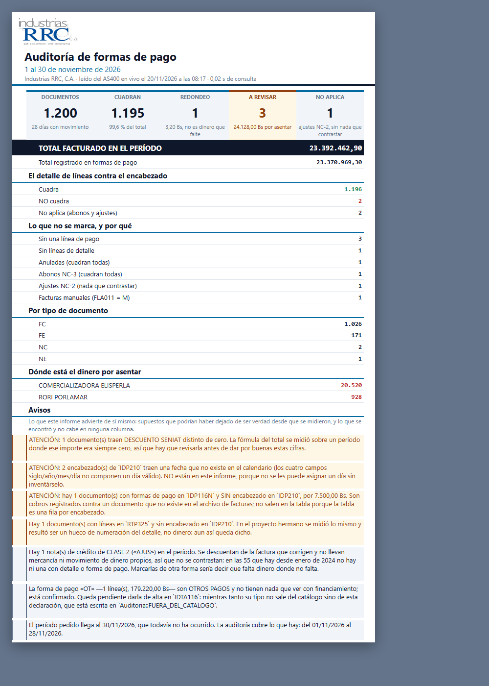
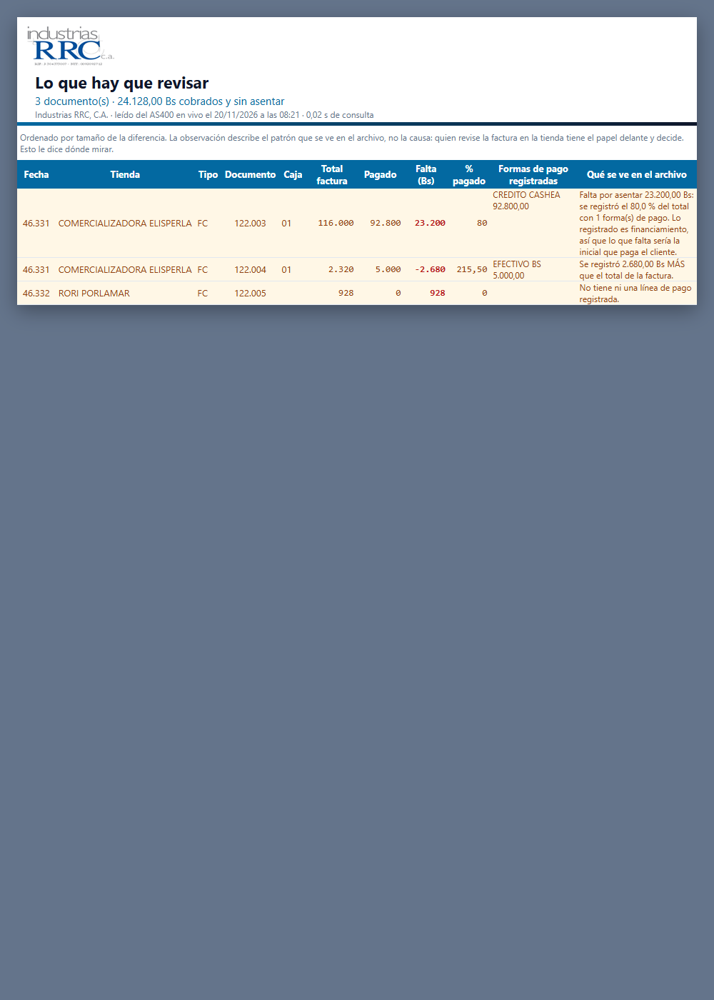
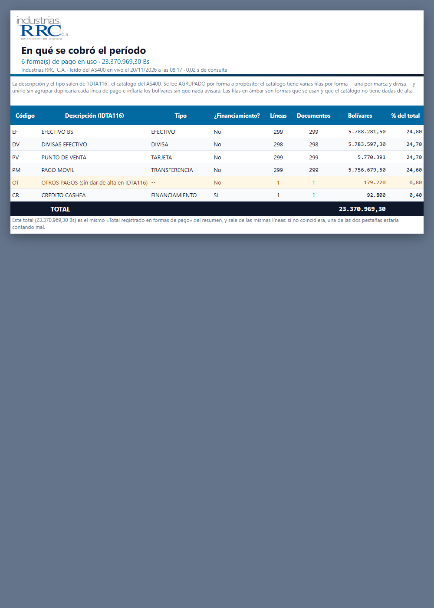
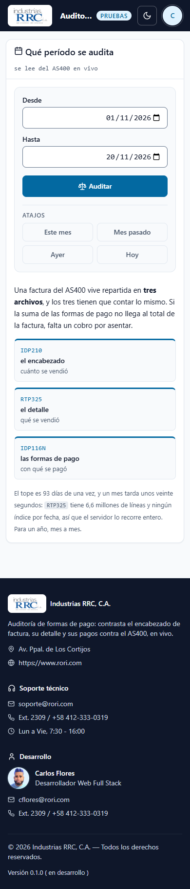

<div align="center">



<br>


<br>

**¿Cuadra cada factura con lo que se cobró por ella?**

Contrasta, documento a documento y leyendo el AS400 en vivo, los tres archivos donde vive una
factura. Si la suma de las formas de pago no llega al total, falta un cobro por asentar.

<br>

[Qué hace](#qué-hace) ·
[Pantallas](#pantallas) ·
[Requisitos](#requisitos) ·
[Instalación](#instalación) ·
[Configuración](#configuración) ·
[Arquitectura](#arquitectura) ·
[Desarrollo](#desarrollo) ·
[Documentación](#documentación) ·
[Seguridad](#seguridad) ·
[Contribuidores](#contribuidores)

</div>

---

## Qué hace

Un documento del AS400 vive repartido en tres archivos, y los tres tienen que contar lo mismo:

```
RORILBRA.IDP210      el ENCABEZADO   cuánto se vendió
RORIVENTAA.RTP325    el DETALLE      qué se vendió
RORIVENTAA.IDP116N   los PAGOS       con qué se pagó

RORIVENTAA.IDTA116   el catálogo de formas de pago
RORIVENTAA.ETP045    el maestro de tiendas
```

Si la suma de las formas de pago no llega al total de la factura, hay dinero cobrado que nadie
registró, o un financiamiento que nadie anotó. **Nadie lo miraba** — no porque no importe, sino
porque son del orden de 3.800 documentos al mes contra 5.200 líneas de pago.

Ya existía una auditoría equivalente en `ventas-ia-agentes`, contra un MySQL que carga el ETL de
madrugada. El juicio está portado entero, con sus justificaciones; lo que cambia es de dónde salen
los datos —**del AS400, en vivo**, así que desaparece el aviso de «estos días no están cargados»— y
que aquí el informe **se mira antes de descargarlo**.

| | |
|---|---|
| **Contrasta los tres archivos** | encabezado, detalle y pagos, documento a documento |
| **Lee el AS400 en vivo** | cinco consultas por ODBC y el cruce en PHP; sin ETL de por medio |
| **Juzga con un corte medido** | `CUADRA` · `REDONDEO` · `REVISAR` · `NO APLICA` |
| **Avisa de sus propios supuestos** | el día que un importe que se dio por cero deje de serlo, el informe lo dice |
| **Se mira antes de descargar** | el Excel es *exactamente* lo que está en pantalla, no una consulta nueva |
| **Escribe el `.xlsx` sin Excel** | cinco pestañas con membrete, listo para llevar en papel a la tienda |
| **También desde la consola** | `php cli/auditoria.php --mes=2026-11 --excel` |

### El veredicto, y por qué está donde está

```
TOTAL = NMODC1 − NMODC2 + NMODC6 + NMOOCG
      =  bruto  − dscto. +  IVA   +  IGTF
```

| Clase | Condición | Qué significa |
|---|---|---|
| `CUADRA` | diferencia ≤ 0,01 Bs | igual al céntimo |
| `REDONDEO` | ≤ 5,00 Bs | redondeo del IGTF, no es dinero |
| `REVISAR` | > 5,00 Bs | hay que ir a ver la factura |
| `NO APLICA` | — | no hay nada que contrastar (ajustes NC-2) |

Ni la fórmula ni el corte en 5 Bs son elecciones de diseño. `IDP210` trae seis importes y ninguno se
llama «total»: se probaron las diez combinaciones razonables contra la suma de pagos de 3.626
documentos y ésta acierta el 98,5 %. Y las diferencias no se reparten por una pendiente —47
documentos entre 0,02 y 4,38 Bs, 8 entre 2.000 y 168.136 Bs, **nada en medio**—, así que el corte
cae en un hueco: moverlo a 10, a 100 o a 1.000 clasificaría igual. El razonamiento completo, con las
cifras, está en [`docs/PLAN.md`](docs/PLAN.md) §3, y la pestaña «Método» del Excel lo lleva dentro
para que el informe se pueda discutir y no sólo creer.

### Qué encontró el primer mes

**Corriendo contra producción desde el 19/11/2026.** Noviembre entero —4.004 documentos,
537.165.668,58 Bs— auditado en **18,26 s**, y todas las reglas aguantaron contra datos reales: la
fórmula del total acierta el **98,7 %**, el contraste del detalle cuadra **3.972 de 3.972 sin un
solo fallo**, y las 110 anuladas y los 31 abonos cuadran como estaba previsto.

Encontró **535.586,27 Bs cobrados y sin asentar** en seis facturas. Una de ellas,
`RORI PORLAMAR · FC 54250`, son **203.239,63 Bs facturados sin una sola línea de pago**.

---

## Pantallas

Se eligen dos fechas y se pulsa **Auditar**; los atajos —este mes, mes pasado, ayer, hoy— rellenan
las fechas y consultan de una vez. El resultado sale ordenado como se decide: el veredicto en cifras
grandes, lo que hay que revisar, los avisos, en qué se cobró, y documento a documento.



Cada fila de la tabla se abre. La ficha trae el diagnóstico entero, de dónde sale el total importe
por importe, el contraste del detalle y el desglose de pagos — para no tener que creerse la cifra:



<table>
<tr>
<td align="center" width="50%"><b>Tema claro</b></td>
<td align="center" width="50%"><b>Tema oscuro</b></td>
</tr>
<tr>
<td></td>
<td></td>
</tr>
</table>

El botón de Excel descarga **exactamente lo que está en pantalla**. Cinco pestañas —Resumen, A
revisar, Auditoría, Formas de pago y Método—, cada una con el membrete de la casa y lista para
imprimir, porque este informe se lleva en papel a la tienda a buscar la factura:

<table>
<tr>
<td align="center" width="33%"><b>Resumen</b></td>
<td align="center" width="33%"><b>A revisar</b></td>
<td align="center" width="33%"><b>Formas de pago</b></td>
</tr>
<tr>
<td></td>
<td></td>
<td></td>
</tr>
</table>

En el móvil la pantalla se reordena: primero el formulario, después el informe.



> [!NOTE]
> Las capturas salen de la pantalla con **datos inventados** —los mismos casos difíciles que fabrica
> [`cli/probar-excel.php`](cli/probar-excel.php)— y por eso la cabecera lleva el distintivo
> `PRUEBAS`. Ni una cifra, ni un cliente ni una tienda de estas imágenes es de producción.

---

## Requisitos

| | | Por qué |
|---|---|---|
| **PHP** | 8.2 | es la del servidor y con la que se prueba (`php -v` → 8.2.12) |
| **Extensión `odbc`** | obligatoria | es la única vía al AS400 |
| **Extensión `zip`** | obligatoria | `ZipArchive` escribe el `.xlsx` |
| **Extensión `mysqli`** | obligatoria | la intranet, de donde salen el usuario y el permiso |
| **Driver ODBC** | *Client Access ODBC Driver (32-bit)* | el nombre exacto va en `AS400_DRIVER` |
| **Apache** | con `AllowOverride` | los `.htaccess` son la mitad de la protección (ver [Seguridad](#seguridad)) |
| **Composer** | **no hace falta** | no hay `vendor/` ni una sola dependencia de terceros |
| **Excel / LibreOffice** | **no hacen falta** | ni en el servidor ni en el equipo que genera el informe |

> [!WARNING]
> **Con la VPN activa no se llega al AS400.** No es un fallo de la aplicación, y es la primera
> sospecha cuando `php cli/probar-as400.php` no conecta. Todo lo que no depende del servidor se
> puede comprobar igual: para eso está `php cli/probar-excel.php`.

---

## Instalación

```bash
# 1. El código, donde lo sirva Apache
git clone <el repositorio> reporte-auditoria-ventas
cd reporte-auditoria-ventas

# 2. La configuración. Los valores los da sistemas; el .env NO se versiona
cp .env.example .env

# 3. ¿Contesta el servidor lo que esperamos? Conexión, los cinco archivos,
#    los campos de cada uno y una consulta de verdad
php cli/probar-as400.php

# 4. ¿El cálculo y el Excel hacen lo que dicen? 62 comprobaciones,
#    sin tocar el AS400
php cli/probar-excel.php
```

No hay paso de `composer install` porque no hay nada que instalar. Los pasos de pruebas contra el
servidor, uno a uno y con lo que tiene que salir en cada uno, están en
[`docs/PRUEBAS-AS400.md`](docs/PRUEBAS-AS400.md).

---

## Configuración

Todo vive en el `.env`, que se copia de [`.env.example`](.env.example). Lo que no está declarado
toma su valor por omisión; lo que está declarado **manda sobre cualquier valor por defecto del
código**.

#### El AS400

| Variable | Qué es |
|---|---|
| `AS400_HOST` | servidor de la conexión ODBC |
| `AS400_USER` · `AS400_PASS` | credenciales; las da sistemas y no se escriben en ningún archivo versionado |
| `AS400_DRIVER` | el nombre exacto del driver instalado. El de IBM se llama «(32-bit)» pero está registrado también en 64 bits, que es lo que usa PHP |
| `AS400_LIBRERIAS` | `produccion` → [`config/librerias.txt`](config/librerias.txt) · `desarrollo` → [`config/libreriasDevs.txt`](config/libreriasDevs.txt) |

> [!CAUTION]
> **`AS400_LIBRERIAS=produccion` no es opcional para auditar.** En `desarrollo`, `IDP210` y
> `IDP116N` apuntan a **copias** en bibliotecas personales. Una auditoría «en vivo» contra una copia
> no da error: da números que están mal sin que se note.

#### La intranet: quién entra y qué puede

| Variable | Qué es |
|---|---|
| `INTRANET_VALIDAR` | `si` exige usuario, id de aplicación y permiso concedido. `no` es el modo de desarrollo: se trabaja como el usuario de pruebas y la cabecera muestra el distintivo `PRUEBAS` |
| `INTRANET_USUARIO_PRUEBAS` | con quién se trabaja mientras `INTRANET_VALIDAR=no` |
| `INTRANET_APP_ID` | el id de **esta** aplicación en la intranet. Vacío y con la validación encendida, la aplicación se cierra a propósito |
| `INTRANET_DB_HOST` · `_PORT` · `_NAME` · `_USER` · `_PASS` | la base de datos de usuarios y permisos |
| `INTRANET_URL_PERFILES` | de dónde cuelgan las fotos de perfil, visto desde esta aplicación |

Lo que **no** va en el `.env`: el nombre de la aplicación, los módulos y las hojas de estilo están
en [`config/app.php`](config/app.php), y la empresa, el soporte, el desarrollador y la versión en
[`config/pie.php`](config/pie.php). Un dato en dos sitios es un dato que se queda viejo en uno.

---

## Arquitectura

MVC propio de la casa, sin framework y sin dependencias.

```
index.php             quién entra; sólo después se pinta algo
controladores/        plantilla.controlador.php
vistas/               plantilla.php + modulos/ (periodo · resultado · pie) + css · js · img
php/auditoria/        los dos puntos de entrada: consultar.php y excel.php
servicios/            Periodo · Auditoria · CacheAuditoria · InformeExcel · LibroExcel · SesionIntranet
modelos/              as400.modelo.php (la base ODBC) · auditoria.modelo.php (las cinco consultas)
config/               app · pie · as400 · librerias(+.txt) · env · intranet · respuesta · texto · bitacora
cli/                  auditoria · probar-as400 · probar-excel · diagnostico-consultas · ver-excel
almacen/              las corridas en caché y los .xlsx generados; ni se versiona ni se sirve
docs/                 PLAN.md · PRUEBAS-AS400.md · INDICE-RTP325.md · img/
```

### El recorrido de una petición

```
navegador ──POST desde+hasta──▶ php/auditoria/consultar.php
                                 │
                                 ├─ SesionIntranet::continuar()  ¿quién es, y puede «visualizar»?
                                 ├─ Periodo::de()                valida el rango (tope 93 días) y lo
                                 │                               parte en meses: en el AS400 no hay
                                 │                               campo fecha, hay siglo/año/mes/día
                                 ├─ Auditoria::correr()
                                 │   ├─ ETP045   tiendas               ~0,1 s
                                 │   ├─ IDTA116  catálogo de formas    ~0,1 s
                                 │   ├─ IDP210   encabezados           ~0,1 s
                                 │   ├─ RTP325   detalle           10 a 45 s  ◀ aquí se va el tiempo
                                 │   ├─ IDP116N  pagos                 ~0,2 s
                                 │   └─ el cruce por clave y el juicio, en PHP
                                 ├─ CacheAuditoria::guardar()    deja la corrida con un token, 30 min
                                 └─ JSON ──▶ vistas/js/auditoria.js   pinta, filtra, abre la ficha.
                                                                      NO calcula nada.

navegador ──GET token─────────▶ php/auditoria/excel.php
                                 └─ CacheAuditoria::leer() ─ InformeExcel ─ LibroExcel ─ .xlsx
```

| Método | Punto de entrada | Qué hace |
|---|---|---|
| `POST` | [`php/auditoria/consultar.php`](php/auditoria/consultar.php) `desde` `hasta` | corre la auditoría y devuelve el informe en JSON, con el token de la corrida |
| `GET` | [`php/auditoria/excel.php`](php/auditoria/excel.php) `?token=…` | el `.xlsx` de **esa** corrida. Sin token, o caducado, vuelve a consultar y el archivo dice dentro a qué hora se leyó el AS400 |

`consultar.php` va por POST aunque sólo lea: un GET lo guardan en caché el navegador y cualquier
intermediario, y una auditoría en vivo que devuelve la respuesta de hace media hora deja de ser en
vivo sin que nadie se entere.

### Cinco consultas y el cruce en PHP

La versión de MySQL lo resolvía en una sentencia con dos subconsultas agregadas y un
`GROUP_CONCAT`. Aquí no: **`GROUP_CONCAT` no existe en DB2 for i** y su equivalente `LISTAGG`
exige que la consulta la resuelva el motor SQL, cosa que no se podía probar mientras se escribía
esto. Cinco consultas simples son cinco planes triviales, y si una falla se sabe cuál.

---

## Desarrollo

Lo primero: **con la VPN activa no hay AS400**, así que el cálculo está partido en dos a propósito.
`Auditoria::correr()` lee y `Auditoria::informar()` juzga, de modo que todo lo que no depende del
servidor se comprueba sin él y lo que queda es exactamente lo que sólo el servidor puede contestar.

```bash
php cli/probar-excel.php              # 62 comprobaciones del cálculo y del .xlsx, SIN AS400
php cli/probar-excel.php --documentos=4000

php cli/probar-as400.php              # conexión, archivos, campos y una consulta de verdad
php cli/probar-as400.php --fecha=2026-11-17

php cli/diagnostico-consultas.php     # por qué tarda, y cuál de las consultas
php cli/ver-excel.php <archivo.xlsx>  # mira un .xlsx en el navegador, sin Excel

php cli/auditoria.php                              # el mes en curso
php cli/auditoria.php --mes=2026-11 --excel
php cli/auditoria.php --desde=2026-11-01 --hasta=2026-11-17 --json
```

`probar-excel.php` fabrica los casos difíciles —el que cuadra al céntimo, el de redondeo del IGTF,
el que falta dinero, el ajuste que no se contrasta, el abono, el anulado, la forma de pago que no
está en el catálogo— y **cada uno declara de antemano qué veredicto tiene que salir**. No es un
«parece que va»: el script falla si sale otra cosa. Existe porque un informe que sólo se puede
comprobar «cuando se pueda» es un informe que no se comprueba.

`ver-excel.php` pinta un `.xlsx` como página web con los anchos, altos, rellenos y fuentes que
declara el propio archivo. No reproduce los formatos numéricos —una fecha sale como su número de
serie— pero contesta las preguntas de diseño, que son las que no se ven en el XML. Con él se
descubrió que las filas de «A revisar» cortaban el diagnóstico por la mitad.

### Cosas que conviene saber antes de tocar el código

<details>
<summary><b>El AS400 no habla UTF-8, y rompe en los dos sentidos</b></summary>

<br>

**De salida.** El campo del año se llama con eñe: `NFAÑDC`. En un archivo PHP guardado en UTF-8 esa
eñe son dos bytes (`0xC3 0xB1`) donde el AS400 espera uno (`0xF1`), así que el nombre que recibe el
servidor no es el del campo y la consulta se rechaza con *«columna no encontrada»* señalando un
campo que sí existe. Lo arregla `ModeloAS400::ejecutar()`, que pasa el SQL entero por
`utf8_a_as400()` antes de prepararlo: **sin esa línea no funciona ninguna de las tres consultas
principales**.

**De entrada.** El driver entrega los textos en la página ANSI de Windows, no en UTF-8. Un solo
acento sin convertir basta para que `json_encode()` devuelva `false`, y `echo false` no imprime
nada: el navegador recibe cero bytes y falla con *«Unexpected end of JSON input»* sin dejar rastro.
Por eso todo valor que sale de un modelo pasa por `as400_a_utf8()` en `ModeloAS400::filas()`.

Las dos conversiones viven en [`config/texto.php`](config/texto.php).

</details>

<details>
<summary><b>Un informe tarda lo mismo para un día que para un mes, y no se arregla aquí</b></summary>

<br>

`RORIVENTAA.RTP325` tiene **6.595.139 filas y ningún camino de acceso por fecha** —ni índice SQL ni
archivo lógico, comprobado contra `QSYS2.SYSINDEXES`—, así que el servidor lo barre entero en cada
consulta. Medido el 19/11/2026: un día (449 filas) tardó 22,22 s y el mes entero (8.547 filas)
17,11 s. Diecinueve veces más datos en el mismo tiempo. En cuanto el filtro encuentra un camino se
desploma: añadiendo la tienda, 1,08 s; por la clave del documento, 0,12 s.

Se descartaron los otros sospechosos uno a uno —el `GROUP BY` de siete columnas, el
`RTPDOC IN (...)`, el campo del siglo— y **se midieron seis variantes de la consulta sin una sola
mejora**. La tentación de «optimizar el `SELECT`» aquí sale cara: lo que falta no está en el
`SELECT`.

El arreglo es una sentencia que no nos toca ejecutar, con la medición que la justifica:
[`docs/INDICE-RTP325.md`](docs/INDICE-RTP325.md). Mientras tanto la pantalla lo dice en lugar de
fingir que avanza.

</details>

<details>
<summary><b>Si las claves no cruzan, el informe sale entero y mal</b></summary>

<br>

Un documento es `fecha + tienda + tipo + número`, y los tres archivos lo guardan con los mismos
valores — pero el driver ODBC no los entrega iguales. `NNMDOC` es `DECIMAL(8,0)` y puede llegar
como `26829`, `26829.` o `00026829` según el archivo y el controlador.

Si no cruzan, **todo sale descuadrado y no hay un solo error que lo delate**: cada factura aparece
sin detalle y sin pagos, que es exactamente la pinta de un mes entero de cobros sin asentar. Por eso
cada parte numérica pasa por `(int)` antes de componer la clave en
`ModeloAuditoria::clave()`, y por eso el paso 7 de `php cli/probar-as400.php` existe: un «0 de 120»
ahí no es un detalle, es que el informe no sirve.

Confirmado el 19/11/2026 contra producción: 209 de 210 con detalle, 208 de 210 con pagos, cero
huérfanos.

</details>

<details>
<summary><b>El `.env` manda sobre el mapa de bibliotecas, no al revés</b></summary>

<br>

[`config/librerias.php`](config/librerias.php) trae `desarrollo` como valor **por defecto**, y ese
valor sólo se usa cuando el `.env` no declara la clave. Si el `.env` la trae, manda el `.env`.
Cambiar el archivo y seguir viendo el otro entorno es exactamente eso.

Importa porque en `desarrollo` el mapa apunta a copias personales de `IDP210` y de `IDP116N`: la
auditoría corre igual, sin un error, contra datos que no son los de la empresa.

El propio archivo arrastra otra cicatriz: estaba escrito con rutas relativas y **nadie lo incluía**,
así que el mapa quedaba vacío, cada `INSERT` remoto fallaba con «la tabla no está definida»… y la
pantalla decía «actualizada satisfactoriamente», porque el resultado no se miraba. Hoy la ruta es
absoluta y un mapa vacío queda anotado en el registro.

</details>

---

## Documentación

| | |
|---|---|
| [`docs/PLAN.md`](docs/PLAN.md) | cómo está armado (§2), el juicio y de dónde salió (§3), la primera corrida contra producción (§3.6), qué está probado y qué no (§4) |
| [`docs/PRUEBAS-AS400.md`](docs/PRUEBAS-AS400.md) | las pruebas contra el servidor paso a paso, y lo que ya salió |
| [`docs/INDICE-RTP325.md`](docs/INDICE-RTP325.md) | la petición a sistemas que convierte veinte segundos en décimas |

**Lo que queda abierto** no es de programación: el índice de `RTP325`, dar de alta la forma de pago
`OT` en `IDTA116` —se usa y no está en el catálogo— y usar la pantalla con el AS400 detrás.

---

## Seguridad

Lo que está comprobado en el archivo que lo sostiene, no lo que sería razonable:

- **El `.env` nunca se sirve.** El [`.htaccess`](.htaccess) de la raíz deniega todo lo que empieza
  por `.env`, y también `.git`, `.gitignore`, los respaldos de editor y los `.bak` `.orig` `.sql`
  `.log`.
- **Las carpetas de código traen su propio `.htaccess` que las deniega enteras:** `config/`,
  `controladores/`, `modelos/`, `servicios/`, `docs/`, `cli/` y `almacen/`.
- **`vistas/` deniega sólo los `.php`** —las plantillas no son páginas— y sigue sirviendo `css`,
  `js` e `img`. **`php/` sí se sirve**, que es la API de la pantalla, pero nada que no sea un `.php`.
- **Los dos puntos de entrada exigen sesión de intranet y el permiso `visualizar`**, y contestan 403
  sin él. `index.php` resuelve quién entra *antes* de pintar nada, y corta con `exit` tras la
  redirección: sin él PHP manda el HTML entero detrás de la cabecera `Location`.
- **Cada archivo de `cli/` comprueba `PHP_SAPI` por su cuenta**, además del `.htaccess`, porque un
  Apache sin `AllowOverride` dejaría de protegerlos y nadie se enteraría.
- **`Options -Indexes`** y `display_errors off` / `log_errors on`: un aviso de PHP impreso en medio
  de una respuesta JSON la rompe de la forma más opaca posible. Al registro sí, a la respuesta no.
- **`almacen/` no se versiona** ([`.gitignore`](.gitignore)): guarda corridas y Excel con ventas
  documento a documento.
- El `.xlsx` se escribe primero a un temporal y sólo cuando está completo se mandan las cabeceras:
  un salto de línea de más antes de ellas se cuela *dentro* del archivo y Excel dice «formato no
  válido» sin más pistas.

---

## Contribuidores

<table>
<tr>
<td align="center" width="260">
<br>
<b>Carlos Flores</b><br>
<sub>Desarrollador Web Full Stack</sub><br>
<sub><i>Diseño, desarrollo y las mediciones contra producción</i></sub><br>
<sub><a href="mailto:cflores@rori.com">cflores@rori.com</a></sub>
</td>
</tr>
</table>

---

<div align="center">


<br>

**Industrias RRC, C.A.** · Av. Ppal. de Los Cortijos · [www.rori.com](https://www.rori.com)

<sub>Soporte técnico · <a href="mailto:soporte@rori.com">soporte@rori.com</a> · Ext. 2309 · Lun a Vie, 7:30 – 16:00</sub>

<sub>Versión 0.1.0 · Aplicación interna de Industrias RRC, C.A.</sub>

</div>
